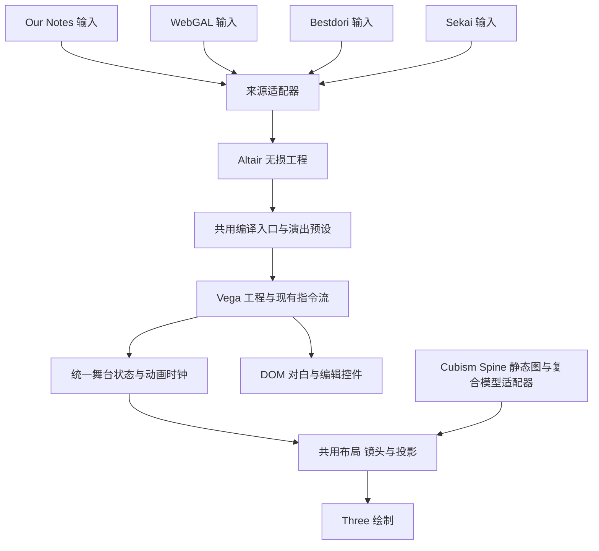

# Vega 与 Altair 统一演出架构

Vega 已有统一指令流、固定坐标转换和可替换模型接口，适合继续收拢。当前还没有完全满足 KISS：DOM 与 Three 的部分镜头状态仍分别调度，来源转换与网站路由也有耦合。Pixi 舞台已从本地实现、预设、插件目录和 Studio 中删除；统一视觉使用 Three。统一工作应沿现有工程和舞台接口推进。

## 当前边界

| 位置                                                 | 已有职责                                      | 需要收拢的部分                                              |
| ---------------------------------------------------- | --------------------------------------------- | ----------------------------------------------------------- |
| `packages/protocol/src/coordinates.ts`               | 固定参考相机、像素与 NDC 到世界坐标、坐标类型 | 各来源和后端共同使用，避免自行推导第二套比例                |
| `src/rendering/StoryPlaneLayout.ts`                  | 图片与模型画布的 contain、cover、对齐和偏移   | 来源适配器生成通用 placement，模型与静态图片共用            |
| `src/rendering/StoryStageGeometry.ts`                | 舞台位置与焦点锚点解析                        | DOM 与 Three 已改为调用同一入口，完整模型控制契约仍需对齐   |
| `src/rendering/AdvCamera.ts`                         | FOV、Focus 和 PanV2 的中立数学                | 各后端仍分别调度镜头补间和持有部分镜头状态                  |
| `src/rendering/StorySceneBackend.ts`                 | 指令执行器与舞台之间的接口                    | 接口过宽，新增模型能力会同时影响多个后端                    |
| `vega-renderer-three`                                | 三维投影、场景组合与 GPU 绘制                 | 持有较多原作演出语义和时序                                  |
| `vega-plugin-webgal`                                 | WebGAL 效果、动画与界面适配                   | 通过统一的屏幕效果、变换和滤镜端口执行，不再创建独立舞台    |
| `altair-plugin-vega-preview`                         | 工程编译、源码映射与预览投影                  | 适合作为演出预设的编译入口，预览与发布保持一致              |
| 网站 `worker/sekai.ts`                               | Sekai 场景解析与资源分发                      | 目前先投影成 `BestdoriScenarioBase`，再调用 Bestdori 转换器 |
| 网站 `packages/bestdori` 与 `altair-plugin-bestdori` | Bestdori 场景与布局转换                       | 网站模块已转为可发布适配库的薄导出，网站与 Altair 共用      |

Altair 已有自己的无损编辑模型，Vega 已有运行工程与 ADV 指令流。继续使用这两层即可；渲染统一不需要增加第三种工程格式。

## 目标分工

来源适配器解释输入，编译器决定演出，舞台计算布局与镜头，绘制后端消费结果。模型适配器继续负责 SDK、动作、表情、口型和出图，并提供统一的画布尺寸、枢轴、身体与头部锚点。

统一舞台计算应接收现有 `AdvPlayerState`、运行配置、模型度量和视口，输出每个对象的变换、裁剪、层级、透明度与效果参数。后端执行图形库坐标适配、资源上传、绘制和释放。投影、位置表、镜头目标和动画曲线各保留一份实现。

图像、Cubism、Spine 和复合模型都可以作为具有深度的角色表面参与同一舞台。模型画布、内容边界、头部锚点必须区分：透明边缘影响画布适配，头部锚点影响特写，二者不能用一个图片高度替代。

这些二维模型表面进入同一透视舞台后，可以共用背景与角色的深度、视差、景深和构图。模型 SDK 继续执行原有动作与表情。焦点在镜头边界采样稳定的角色锚点，需要持续跟随时使用既有 Track 语义，避免逐帧根据透明边界或呼吸动画重新构图。

## 四类输入的归一化

统一世界坐标沿用当前协议的 `+X` 向右、`+Y` 向上、`+Z` 向前。源像素先按固定参考画面转换为 NDC，再转换为世界坐标。此转换发生在导入或编译时，后续镜头移动只改变投影。

| 输入      | 需要保留的来源信息                                                                       | 转换到共用舞台                                                                           |
| --------- | ---------------------------------------------------------------------------------------- | ---------------------------------------------------------------------------------------- |
| Our Notes | 原始指令、位置表、FOV、焦距表、模型单位、时间轴与效果数据                                | 保持原作参数与时序，作为兼容基线                                                         |
| WebGAL    | 舞台尺寸、定位模式、图像或模型画布、左右位置、像素变换、弧度旋转、独立缩放、滤镜与关键帧 | 定位模式在适配器中生成通用 placement；像素变换转换为共用通道，后端不再识别 WebGAL 命令名 |
| Bestdori  | 原始 side、偏移、深度、移动速度、动作与表情、对白角色关系                                | 使用已有固定参考相机与坐标工具，保留身份和时间关系                                       |
| Sekai     | LayoutData、Snippets、TalkData、动作与表情、服装、深度、语音和特效                       | 独立解释 Sekai 语义后直出同一编辑模型，逐步替换借用 Bestdori 中间格式的路径              |

来源差异留在适配器和配置数据中。原始演出模式保留来源布局；Our Notes 模式使用统一的舞台与镜头预设。两种模式共用绘制逻辑。

模型资源仍使用各自格式。转换目标是统一角色位置、大小、锚点和演出控制，不需要把 Cubism 文件改造成 Spine 文件。

## WebGAL 工程的一键 Our Notes 演出

预设保存在工程中，编译产生派生指令，原脚本和资源保持可恢复。预览、网页运行、Deneb 构建使用同一个编译入口。

1. 导入场景、变量、分支、音频、动作、表情和资源，保留原始源码映射。
2. 根据模型画布与内容边界校准角色大小，将角色放入共用舞台位置，并分离背景与角色的深度。
3. 当前规则预设按对白与角色绑定生成已有的 Focus 指令；更多运动由作者使用现有镜头指令编排。
4. 连续同一说话人保持当前镜头；多人对白、旁白和选择项使用合适的全景。手工镜头优先。
5. 保存预设选择和角色绑定，可切回原始演出，也可把生成结果显式烘焙为可编辑命令。

普通对白先使用稳定、可复现的聚焦规则。先完成全景、单人和双人构图，再增加少量有明确含义的预设。预设数量与来源格式、模型 SDK、渲染后端不做组合扩张。

角色绑定使用稳定身份。显示名字、模型文件名与角色 ID 不一定相同；没有可靠绑定时保留全景，编辑器允许作者补充对应关系。每条生成命令保留来源语句 ID，预览定位、撤销、断点、跳转和存档都能回到原语句。

Our Notes 镜头在 Vega 舞台上执行。输出目标需明确区分 Vega 工程与原生 WebGAL 工程；后者继续遵守 WebGAL 自身的运行能力。编辑器应提供实际可运行的目标，不能在导出时静默丢掉所选演出。

## 指令兼容边界

- `0–100` 的编号、参数含义、默认值、等待与并行时序保持原作兼容；空位保留。
- 一键演出优先展开成现有指令，不为“特写”“说话人聚焦”等预设各建一个 opcode。
- 确有新增原语时，使用既有官方扩展区和命名空间机制，并为旧工程保留版本化入口。
- 已从正式 Intl 1.0.1 的 metadata 枚举默认值确认 `MotionLoop=68`、`EyeBlink=69`。它们属于原作兼容区，保留编号并补齐原作语义。

`68` 使用独立参数循环通道，与主动作同时存在；启动和停止都使用指令的 `motionFadeIn`，shortcut 为零。`69` 的空参数切换会话中该角色的停止状态，`stop` / `resume` 按 ordinal case-insensitive 比较，空白不裁剪；无效值不改变状态。停止状态在角色未入场时也要保留，模型过渡为 `0.2f` 秒，shortcut 为零。内核、Three 与 Cubism 适配器已按这些语义实现独立循环、停止状态和渐变恢复。

反编译还显示 Store150、Pose200、Expression300、ParameterLoop350、Eye400、Mouth500 的更新顺序。共用演出层应维护角色状态、场景时钟与恢复事件；模型 provider 按该顺序求值参数；绘制后端不接管模型控制器。独立循环与状态恢复已合入对应模型接口；原作参数通道顺序继续作为核对依据。

模型能力通过统一的角色状态与可选能力契约表达。参数循环、眨眼等模型控制应归角色适配器，避免每新增一个模型功能就给所有舞台后端增加四个必选方法。

## Altair 的职责与网页接入

Altair 维护一份工程与事务历史。源码、可视化、时间轴和流程图都是同一模型的编辑视图；预览使用实际发布编译器。工程文件、草稿、历史、外部文件冲突分别有明确所有者，避免多套自动保存同时写入。

网页首先使用独立编辑路由承载完整 Studio。重型模块按路由加载，首阶段用受控 iframe 隔离当前全局 CSS 与播放器状态，接入主题、语言和公共资源。引擎预览中的可执行工程代码使用独立的沙箱边界。

网站 AppShell 拥有页面标题与导航。随着接口稳定，再把工程状态和少量保存、返回、导出动作接到应用栏。宿主只传主题、语言、资源引用与经过范围限定的工程操作，模型 SDK、渲染生命周期和源码转换继续由现有模块负责。

当前 Studio 的 `editor.css` 包含 `:root`、`body`、全局控件选择器，直接挂到站点 DOM 会影响其他页面。组件化嵌入需要先完成样式作用域、Portal 容器、Monaco 样式和实例销毁契约。iframe 可先提供完整功能，再逐步收敛这些边界。

## 实施顺序与完成条件

| 顺序 | 工作                                         | 完成条件                                                       |
| ---- | -------------------------------------------- | -------------------------------------------------------------- |
| 1    | 核对本地补丁与兼容表，闭合模型控制契约       | Vega、Three、模型适配器、WebGAL 插件与 Altair 完整源码检查通过 |
| 2    | 收拢固定坐标、模型 placement、焦点与镜头数学 | 同一工程使用不同模型格式时，位置、时长、锚点和镜头目标一致     |
| 3    | 收拢动画时钟、补间所有权与效果通道           | 播放、暂停、跳转、取消和确定性恢复使用同一份状态               |
| 4    | 完成来源适配器，加入可逆演出预设             | 四类来源都能保留源码、校准模型、预览并导出同一演出结果         |
| 5    | 补齐编辑器成熟度与网页宿主集成               | 功能矩阵逐项验收，桌面与手机、明暗主题、真实工程完整验证       |

验收使用已有构建检查与真实工程：比较角色脚线和头部位置、背景裁剪、镜头焦点、关键帧时间、对白对应关系、暂停恢复和导出后播放。功能矩阵与源码存在性分别记录，避免把接口声明等同于完成渲染支持。

## 镜头编排依据

摄影运动从剧本意图、人物关系和画面中发生的变化开始。关注对象可以是说话人、倾听者、关系中的另一方或尚未揭示的信息。开场先交代空间关系，转折再改变景别；沉默可以保持当前构图。镜头运动的开始、结束与停留分别设计，运动时长不代表镜头停留时长。

连续性包括人物左右、视线方向、运动方向、空间轴线和切换前后的画面尺度。单面立绘、Cubism 与 Spine 适合共用舞台上的推拉、摇移、跟随和有限视差；环绕到角色背面需要相应的素材与场景。焦距变化与移动相机具有不同透视结果，不能以同一个缩放效果替代。字幕区、脸部与手机裁切均参与构图约束。

当前规则预设是可逆的稳定基线：连续同一对象保持，未知或多人对象回到全景，选项和输入回到全景，场景内已有作者镜头时保留作者编排。它不分析戏剧转折。作者可以在现有时间轴、Focus、PanV2、Track、Pedestal、Zoom、Tilt 中安排完整段落；无需新增 opcode。

语义 AI 的合适边界是制作阶段的候选镜头计划。沿现有 AI provider 与变更审核事务，输入作者选中的段落、稳定 scene/node/actor ID 和角色关系，输出“意图、关注对象、景别、运动起止与停留”的候选。约束规划器核对演员、资源、连续性、字幕安全区和手工镜头，再展开成现有指令。作者比较、编辑、撤销并保存结果；播放、暂停、跳转、读档与离线导出均执行保存的确定指令。此处是设计边界，当前没有启用远程语义导演。

验收按安静对话、冲突、情绪转折、多人移动和交互选择分别观看，评价叙事理解、关系表达、节奏、构图与观看舒适。平滑度和镜头数量不能单独代表电影感。原作固定版本的镜头参数用于校准，与专业镜头原则一起判断具体段落。

参考资料：

- Bruce Block，[The Visual Story，第三版](https://www.routledge.com/The-Visual-Story-Creating-the-Visual-Structure-of-Film-TV-and-Digita/Block/p/book/9781315794839)，2021：视觉结构与故事节奏。
- Walter Murch，[In the Blink of an Eye，第二版](https://www.silmanjamespress.com/shop/filmmaking-directing/in-the-blink-of-an-eye2nd-edition/)：剪辑与情绪、连续性。
- Jay Holben，[Shot Craft: Tools for Camera Movement](https://staging.ascmag.com/articles/shot-craft-camera-movement)，American Cinematographer，2024：从剧本与运动目的选择摄影方法。
- Galvane 等，[Continuity Editing for 3D Animation](https://team.inria.fr/imagine/files/2014/11/continuitystyle.pdf)，AAAI 2015：结合镜头质量、连续性与节奏进行序列规划。
- Ronfard 等，[Prose Storyboard Language v2](https://diglib.eg.org/items/6600dfc3-fbcf-4784-8166-b299e2cb5a2b)，WICED 2022：明确表示构图与屏幕事件。
- Kizil 等，[LAMP](https://arxiv.org/abs/2512.03619)，CVPR 2026：语言意图到结构程序与确定轨迹；研究对象是视频生成。
- Wang 等，[CineTechBench](https://arxiv.org/abs/2505.15145)，2025 预印本：电影技法的多维标注与模型能力评估。

Screen Studio 的[可编辑缩放区间](https://screen.studio/guide/adding-editing-zooms)提供“识别关注对象、保留人工调整”的交互参考。故事中的关注对象来自剧情与表演，不应使用鼠标位置决定相机。
